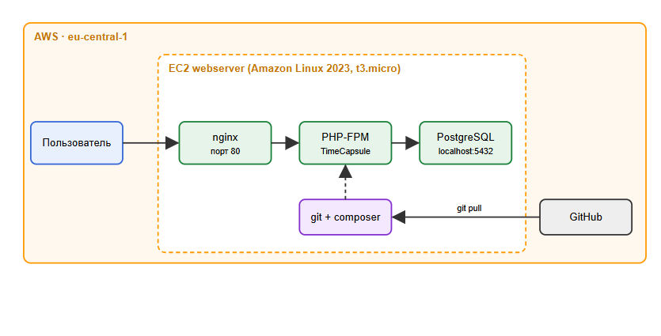

# Лабораторная работа №2. Облачные вычислительные сервисы — Amazon EC2

**Студентка:** Горбатюк Эвелина  
**Группа:** IA2403  
**Специальность:** Informatică aplicată, 3 курс  
**Уровень:** Продвинутый (задания 1–14)  
**Приложение:** TimeCapsule (PHP без фреймворка)  
**Деплой:** Вариант A — вручную через команды на сервере  
**GitHub:** https://github.com/Cloud-Computing-Evelina/timecapsule

---

## Описание работы

В этой лабораторной работе я создала и настроила виртуальный сервер Amazon EC2, установила необходимые программы и развернула веб-приложение TimeCapsule.

Также я проверила работу сервера, обновление приложения и восстановление предыдущей версии после ошибки.

## Часть 1. Базовый уровень

### Задание 1. Подготовка AWS

- Выбрала регион `eu-central-1` (Frankfurt).
- Создала IAM-группу `Admins` с правами `AdministratorAccess`.
- Создала IAM-пользователя и добавила его в группу.
- Создала бюджет `ZeroSpend` для контроля расходов.

**Скриншот 1**


**Вопрос:** Что разрешает AdministratorAccess и почему нельзя работать под root?

AdministratorAccess даёт полный доступ к AWS. Root имеет неограниченные права, поэтому для обычной работы лучше использовать IAM-пользователя с необходимыми разрешениями.

### Задание 2. Создание EC2

Создала экземпляр EC2 со следующими параметрами:

- OS: Amazon Linux 2023
- Instance type: `t3.micro`
- Region: `eu-central-1`
- Web server: nginx

После запуска проверила публичный IP и убедилась, что стартовая страница nginx открывается.

**Скриншот 2**


**Скриншот 3**


**Вопрос:** Что такое User Data?

User Data — скрипт, который AWS выполняет при первом запуске экземпляра. Обычно он используется для автоматической установки и настройки программ.

### Задание 3. Мониторинг и диагностика

Проверила состояние сервера с помощью:

- Status checks
- Monitoring
- System log
- Instance screenshot

**Скриншот 4 — Monitoring**


**Скриншот 5 — System log**


**Вопрос:** Какая проверка отвечает за AWS, а какая за мой сервер?

- System status check — проблемы на стороне AWS.
- Instance status check — проблемы с операционной системой или настройками экземпляра.

### Задание 4. Подключение по SSH

Подключилась к серверу через PowerShell:

```powershell
ssh -i $HOME\.ssh\<ключ>.pem ec2-user@<Public-IP>
```

**Скриншот 6**


**Вопрос:** Почему используется ключ, а не пароль?

SSH-ключ обеспечивает более надёжную аутентификацию и защищает от обычного подбора пароля.

### Задание 5. Размещение статического сайта

Создала три HTML-страницы:

- `index.html`
- `about.html`
- `contact.html`

С помощью `scp` скопировала файлы на сервер и разместила их в директории nginx.

**Скриншоты 7**


**Вопрос:** Что делает scp?

`scp` копирует файлы между компьютерами через SSH.

### Задание 6. Остановка EC2 через AWS CLI

Остановила сервер с помощью команды:

```bash
aws ec2 stop-instances --instance-ids <ID> --region eu-central-1
```

**Скриншот 8**


**Вопрос:** Чем отличаются Stop и Terminate?

- **Stop** — останавливает сервер, но сохраняет его экземпляр и корневой диск. За хранилище продолжает начисляться плата.
- **Terminate** — удаляет экземпляр EC2. Данные на удаляемых дисках могут быть потеряны.

---

## Часть 2. Продвинутый уровень

### Архитектура приложения

Приложение TimeCapsule использует три основных компонента:

| Компонент | Назначение |
|---|---|
| nginx | Принимает HTTP-запросы |
| PHP-FPM | Выполняет PHP-код |
| PostgreSQL | Хранит данные приложения |

PostgreSQL настроен для локального доступа с сервера.

### Задание 7. GitHub: организация и репозиторий

Создала организацию `Cloud-Computing-Evelina`, репозиторий `timecapsule` и загрузила исходный код приложения.

**Скриншот 9**


**Вопрос:** Почему vendor/ и .env не добавляются в репозиторий?

- `vendor/` можно восстановить командой Composer.
- `.env` содержит пароли и другие секретные настройки, поэтому его нельзя публиковать.

### Задание 8. Установка программ на сервер

Установила необходимые компоненты:

- Git
- Composer
- PHP и PHP-FPM
- PostgreSQL
- Необходимые расширения PHP

**Вопрос:** Почему установка выполнялась вручную, а не через User Data?

Сервер уже был создан ранее, поэтому я установила программы вручную, чтобы отдельно проверить каждый этап настройки.

### Задание 9. Настройка PostgreSQL

Установила и настроила PostgreSQL, создала отдельного пользователя и базу данных `timecapsule`.

**Скриншоты**


### Задание 10. Развёртывание приложения

Выполнила следующие действия:

1. Склонировала репозиторий GitHub.
2. Настроила файл `.env`.
3. Установила зависимости через Composer.
4. Подготовила базу данных.
5. Инициализировала приложение.

**Скриншоты**


**Вопрос:** Почему пароль хранится в `.env`, а не в коде?

Чтобы не публиковать пароли и другие секретные данные вместе с исходным кодом.

### Задание 11. Настройка nginx и PHP-FPM

Настроила nginx для работы с PHP-FPM и проверила приложение.

Также проверила адрес `/health`, который используется для проверки доступности приложения и базы данных.

**Скриншоты**


### Задание 12. Обновление приложения

Для обновления приложения использовала Git и Composer:

```bash
cd /var/www/timecapsule
git pull
composer install --no-dev
php bin/init-db.php
sudo systemctl reload php-fpm
```

**Вопрос:** Что может увидеть пользователь во время git pull?

При обновлении пользователь может столкнуться с временной ошибкой или некорректной работой сайта, если файлы обновляются не одновременно.

Если не установить зависимости через Composer, приложение может перестать работать.

### Задание 13. Проверка обновления, ошибка и откат

Сначала проверила работу приложения: зарегистрировала пользователя и создала капсулу.

Затем:

1. Добавила своё имя в подвал страницы.
2. Отправила изменения в GitHub.
3. Обновила сервер через `git pull`.
4. Проверила, что изменения появились, а данные сохранились.

После этого специально добавила синтаксическую ошибку в PHP-шаблон. Главная страница начала возвращать ошибку 500.

При этом `/health` продолжал отвечать `ok`, поскольку проверял доступность PHP и базы данных, но не правильность работы всех страниц.

**Откат изменений:**

На локальном компьютере:

```bash
git revert <коммит>
git push
```

На сервере:

```bash
cd /var/www/timecapsule
git pull
composer install --no-dev
sudo systemctl reload php-fpm
```

После отката сайт снова заработал.

**Вопрос:** Почему `/health` отвечал ok, хотя сайт не работал?

Потому что проверка `/health` не обнаруживает все ошибки приложения, например синтаксические ошибки в отдельных шаблонах.

**Вопрос:** Сколько времени сайт был недоступен и как это исправить?

Примерно 5–10 минут. Сократить время можно с помощью автоматических тестов, CI/CD и автоматического отката при ошибках.

## Задание 14. Архитектура и ADR

### Схема архитектуры



На схеме показано:
- Пользователь обращается к nginx (порт 80)
- nginx передаёт запросы в PHP-FPM (приложение TimeCapsule)
- PHP-FPM работает с PostgreSQL (localhost:5432)
- Код обновляется с GitHub через `git pull` + composer

### ADR

Файл ADR: [docs/adr/0001-deploy-method.md](docs/adr/0001-deploy-method.md)

---

## Контрольные вопросы

**1. Как проходит HTTP-запрос?**

Браузер отправляет запрос → nginx принимает его → PHP-FPM выполняет PHP-код → при необходимости обращается к PostgreSQL → возвращает ответ.

**2. Почему сервер может скачать код из GitHub, но не может отправить изменения?**

Поскольку репозиторий публичный, его можно читать без авторизации. Для отправки изменений нужны права на запись.

**3. Что произойдёт с данными после Terminate?**

Если данные находятся на удаляемом корневом диске, они будут потеряны. Поэтому необходимо использовать резервные копии или отдельное хранилище.

**4. Что общего между ручным деплоем и CI/CD?**

Оба способа включают получение кода, установку зависимостей, обновление базы данных и перезапуск необходимых сервисов. Разница в том, что при ручном деплое команды запускает человек, а при CI/CD — автоматизированный процесс.

---

## Итог

В ходе лабораторной работы я:

- Настроила AWS и создала EC2.
- Подключилась к серверу через SSH.
- Установила nginx, PHP, PHP-FPM и PostgreSQL.
- Развернула приложение TimeCapsule из GitHub.
- Настроила базу данных.
- Проверила обновление приложения.
- Смоделировала ошибку и выполнила откат версии.
- Подготовила архитектурную схему и ADR.

**Результат:** приложение TimeCapsule успешно развёрнуто на Amazon EC2. Я проверила основные этапы его настройки, обновления и восстановления после ошибки.
